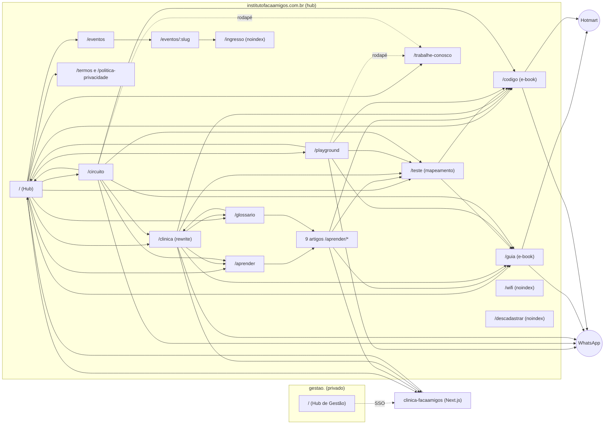

# Mapa do site FaçaAmigos

Atualizado em 02/11/2026, a partir do código do repositório. A seção 0 é a arquitetura atual; as demais seções descrevem as rotas (conferir a seção 0 antes de confiar nas colunas de arquivo).

## 0. Arquitetura atual (nov/2026)

O site é construído com **Astro 7** (estático). Fluxo: `src/` e `public/` → `npm run build` → `dist/` → Vercel.
`vercel.json` fixa `framework: null`, `buildCommand` e `outputDirectory: "dist"`; o `middleware.js` (Routing Middleware) continua na raiz.

| Pasta | O que tem |
|---|---|
| `public/` | Tudo que já era servido, copiado **como está**: as páginas HTML ainda não migradas, `assets/`, `img/`, `audio/`, `sitemap*.xml`, `llms*.txt`, `geo-facts.json`... |
| `src/pages/` | Páginas Astro: `quem-somos`, `playground/*`, `equipe/*`, `clinica/equipe`, `aprender` (índice), `aprender/[slug]` (os 19 artigos), `clinica/[slug]` (15 especialidades), `autismo`, `tdah` e `neurodivergencia` (páginas pilar de condição), `glossario`, `termos`, `politica-privacidade`, `404`, `trabalhe-conosco` e `eventos`. |
| `src/data/` | **Fonte única dos fatos**: `marca.json` (contatos, endereço, andar, CNPJ, horário da Clínica), `equipe.json`, `artigos.json`, `especialidades.json`. `marca.ts` deriva o horário de `public/geo-facts.json` (vem do caixa). |
| `src/components/`, `src/layouts/`, `src/styles/` | `Base` (head, GTM, JSON-LD), `Nav`, `Footer`, `Foto`, `FAQ`, `UnidadePagina`; tokens do kit da Clínica em `global.css`. |
| `scripts/` | `check.mjs` verifica o **site construído** (`dist/`): rode `npm run build && npm run check`. |

### Onde editar cada coisa
- **Telefone, endereço, andar, referência, CNPJ:** `src/data/marca.json` (o rodapé é `src/components/Footer.astro`, estático, lido de `marca.json`; o mesmo número ainda existe em `public/assets/fa-footer.js`, usado só por `descadastrar.html`: o `check` falha se divergirem).
- **Horário e preço do Playground/Circuito:** vêm do caixa. Corrigir no cadastro da unidade e rodar `npm run geo`. O domingo (12h às 21h) fica em `supabase/functions/geo-facts/index.ts` (`sundayOpen`/`sundayClose`).
- **Horário da Clínica:** `src/data/marca.json` → `horarioClinica`.
- **Publicar um profissional:** `src/data/equipe.json`, `publicar: true` (só com aprovação dele). Com 2 ou mais perfis, `/clinica/equipe` passa a ser indexável e entra no sitemap.
- **Texto do glossário, termos, política, índice de Aprender, 404, trabalhe conosco e eventos:** `src/data/paginas/<slug>.html` (o texto), `<slug>.json` (metadados e JSON-LD) e `<slug>.N.js` (scripts da página, copiados como estavam). Os cartões do índice de Aprender saem do campo `card` de cada artigo.
- **Especialidade da Clínica (`/clinica/<slug>`):** `src/data/especialidades/<slug>.json` (metadados, resposta curta, FAQ, `relacionadosSlugs`, `revisor`) + `<slug>.html` (texto). **Condição (`/autismo`, `/tdah`, `/neurodivergencia`):** `src/data/condicoes/<slug>.json` + `.html`. As duas usam `src/components/PaginaSaude.astro` (schema `MedicalWebPage` + FAQ + trilha). `revisor` fica `null` até um profissional real revisar e aprovar: só então a página mostra "Revisado por" e o schema ganha `reviewedBy`. O `check.mjs` barra "melhor clínica", promessa de resultado, "cura", conteúdo raso (<450 palavras) e `reviewedBy` fora da psicologia. `llms*.txt` listam as páginas sozinhos (`npm run geo`).
- **Texto de um artigo de Aprender:** `src/data/aprender/<slug>.html` (o texto) e `<slug>.json` (título, metadados, botões, "leia também"). Um artigo novo = um par de arquivos novo; a rota `aprender/[slug]` gera a página. A URL entra em `public/sitemap.xml`.
- **Vagas abertas (JobPosting):** um `.json` por vaga REAL em `src/content/vagas/` (modelo e regras em `_LEIA-ME.md` na mesma pasta). Ela vira `/trabalhe-conosco/<arquivo>` com o schema JobPosting e aparece em "Vagas abertas agora" na `/trabalhe-conosco`; depois do `validaAte` sai no próximo deploy (a página avisa "encerrada" antes disso). Sem nenhuma vaga, nada muda: a página é só o formulário geral (banco de talentos, sem schema).
- **Landing de campanha (Fase 5):** um `.json` por campanha REAL em `src/content/campanhas/` (modelo e regras em `_LEIA-ME.md`). Vira `/lp/<arquivo>`: `noindex`, sem o menu do site, rodapé enxuto (CNPJ, endereço, privacidade), botão de WhatsApp da unidade escolhida (ou link) e barra fixa no celular. O build recusa texto com termos proibidos pela marca (festa, aniversário, promessa, confiança, oferta). Não entra no sitemap. Sem nenhum arquivo, nada é publicado.
- **Nova página:** `src/pages/x.astro` usando `Base`; depois `npm run build && npm run sitemap`: a URL entra sozinha em `public/sitemap.xml` (páginas com canonical do hub e sem noindex; changefreq 0.6/monthly por padrão, ajustável no arquivo) e o `lastmod` vem do git. Commitar o `sitemap.xml`.

### Pendências conhecidas
- As páginas legadas em `public/*.html` (ingresso, descadastrar e família) ainda não foram migradas e repetem cabeçalho, rodapé e CSS.
- `/trabalhe-conosco`: a estrutura de vagas com `JobPosting` está pronta (`src/content/vagas/`), mas nenhuma vaga foi publicada ainda (faltam os dados reais de cada vaga); `/parcerias` (depende de haver oferta de dia útil); landings `/lp/<campanha>`: a estrutura está pronta, falta a primeira campanha real.
- `evento` (acoplada ao `middleware.js`, que reescreve o HTML dela por texto exato), `ingresso`, `teste` (questionário), `guia` e `codigo` (checkout da Hotmart) e as páginas grandes de venda ficaram de fora de propósito: têm lógica ou CSS próprio que exige migração com mais cuidado.
- `sitemap.xml` é gerado a partir das páginas construídas (`npm run build && npm run sitemap`) e fica versionado em `public/`: o `lastmod` sai do git local, e o CI faz checkout raso. `sitemap-playground.xml` segue fixo (transição).
- Hoje são servidos publicamente `NEWVITTA/`, `contexto.md`, `EXPERIMENTOS-TV2.md` e `chatbot-clinica/`. Decidir se saem de `public/`.
- ~~Textos "em breve no Umarizal" e "lista de espera"~~: corrigidos (a Clínica já atende).
- **`/direitos`** (passo a passo de benefícios): dados em `src/data/direitos.json`, página em `src/pages/direitos.astro`. Escrita com base na legislação federal e conferida em 04/11/2026 por pesquisa na web (sites jurídicos, universidades e notícias; **os textos oficiais do Planalto/ANS não foram abertos**), **sem links externos**. A CIPTEA no Pará é emitida pela Sespa (lei estadual 5.310/2026). Revisar por advogado(a) quando possível. Ficaram de fora, por incerteza: isenção de impostos na compra de carro (reforma tributária em transição), IPVA no Pará e transporte urbano em Belém.
- Preço do Parque no caixa (50% para o público geral) diverge do site e de `geo-facts.json` do repositório (40%).

## 1. Domínios e quem serve o quê

| Domínio | O que é | Onde vive | Indexa? |
|---|---|---|---|
| `institutofacaamigos.com.br` | Hub: institucional, conteúdo, funil de e-books, eventos, Wi-Fi | este repositório (Vercel) | sim |
| `playground.institutofacaamigos.com.br` | Host antigo: só redireciona (308) para `/playground` e `/circuito` do hub. Nunca remover o domínio | este repositório (mesmo deploy) | não (redireciona) |
| `gestao.institutofacaamigos.com.br` | Hub de Gestão (login único, só Bruno e Isabella) | este repositório (mesmo deploy) | não (noindex + robots Disallow) |
| `institutofacaamigos.com.br/clinica` | Landing pública da Clínica (serviços, convênios, FAQ) | **este repositório**: `public/clinica.html`, servida por cleanUrls. (Versão antiga deste mapa dizia que era o projeto `clinica-facaamigos` via rewrite; esse rewrite não existe no `vercel.json`.) | sim |
| `clinica.institutofacaamigos.com.br` | Host antigo da landing: só redireciona (301) para `/clinica`; o resto vai (308) para `sistema.` | projeto `clinica-facaamigos` | não (redireciona). Manter o domínio apontado |
| `sistema.institutofacaamigos.com.br` | Sistema de gestão da Clínica (login, agenda, prontuário, portal da família) | projeto `clinica-facaamigos` | nunca (noindex, robots Disallow, sem link nas páginas públicas) |

Desde 09/10/2026 o Playground e o Circuito moram no hub (`/playground` e `/circuito`). O `middleware.js` faz o host
`playground.` redirecionar (308) tudo para o hub (`/` vira `/playground`; o resto mantém o caminho e a query).
Arquivos (`.txt`, `.xml`, `.ico`, `.well-known`) passam em qualquer host; `playground./sitemap.xml` serve o
`sitemap-playground.xml`, de transição (URLs antigas, para o Google enxergar os redirecionamentos; pode sair ~3 meses depois).

## 2. Diagrama de navegação

## 3. Páginas do hub (institutofacaamigos.com.br)

| Rota | Arquivo | Papel | No sitemap | Observação |
|---|---|---|---|---|
| `/` | index.html | Hub: porta de entrada para Playground, Circuito, Clínica, guias, carreiras | sim | seção de próximos eventos |
| `/trabalhe-conosco` | trabalhe-conosco.html | Carreiras: áreas, tipos de vaga e formulário de candidatura com currículo em PDF | sim | envia para a função `job-application-webhook` (mesmo endpoint do antigo modal); no `playground.` redireciona (308) para o hub |
| `/playground` | playground.html | Playground Inclusivo (antes em `playground.`) | sim | canonical no hub |
| `/circuito` | circuito.html | Circuito de Carrinhos (antes em `playground.`) | sim | canonical no hub |
| `/clinica` | (projeto clinica-facaamigos) | Landing da Clínica: serviços detalhados, ambiente, convênios, FAQ, lista de espera | sim | rewrite para o app da Clínica; `/servicos` redireciona (301) para cá |
| `/aprender` | aprender.html | Índice de artigos | sim | |
| `/aprender/*` (9) | aprender/*.html | Artigos: birra-ou-crise, sinais-para-observar, primeira-vez-no-playground, rotina-visual-em-casa, como-e-a-terapia-comportamental, laudo-e-ciptea, conversar-com-a-escola, brincar-com-proposito-10-minutos, e-para-todas-as-criancas | sim | cada um leva ao /teste, à Clínica e ao WhatsApp |
| `/glossario` | glossario.html | Termos explicados | sim | |
| `/teste` | teste.html | Mapeamento comportamental (funil principal) | sim | perguntas em `teste-perguntas.json` |
| `/guia` | src/pages/guia.astro (texto em src/data/paginas/guia.*, CSS escopado em src/styles/lp/guia.css) | E-book "O Brincar com Propósito" (capítulo grátis + Hotmart) | sim | |
| `/codigo` | src/pages/codigo.astro (texto em src/data/paginas/codigo.*, CSS em src/styles/lp/codigo.css) | E-book "O Código do Desenvolvimento Infantil" (Hotmart) | sim | |
| `/eventos` | eventos.html | Lista de encontros, palestras e treinamentos | sim | dados vêm da função `eventos-public` |
| `/eventos/:slug` | src/pages/evento.astro (texto em src/data/paginas/evento.*) | Detalhe e inscrição | não | `vercel.json` reescreve para `/evento`; canonical aponta para `/eventos`. O `middleware.js` troca metas/h1/spans por texto exato: ao mexer na página, rode a simulação do middleware (título, canonical, og:*, robots, h1) |
| `/ingresso` | ingresso.html | Voucher com QR do inscrito | não | noindex, Disallow no robots |
| `/wifi` | wifi.html | Portal do Wi-Fi da clínica | não | noindex, follow |
| `/familia` | familia.html | Como entrar no Portal da Família (3 passos + botão para o login do sistema). Destino do QR da TV da sala de espera (`/tv3`) | não | noindex, nofollow |
| `/termos` | termos.html | Termos de uso e de compra | sim | |
| `/politica-privacidade` | politica-privacidade.html | LGPD | sim | dono: hub |
| `/descadastrar` | descadastrar.html | Sair da sequência de e-mails | não | noindex |
| `/admin` | admin.html | Painel do teste | não | noindex, no-store |
| `/gestao` | gestao.html | Hub de Gestão | não | só pelo host `gestao.` |
| `/tv` | tv.html | Vitrine Digital e canal de cultura para as Smart TVs das operações (/vitrine-digital) | não | noindex (uso interno nas lojas) |
| `/tv2` | tv2.html | Vitrine Digital da TV 50" deitada 90º (retrato) do Quiosque do Circuito — só carrinhos, preço R$ 48,00 · 20/30 min | não | noindex (uso interno quiosque) |
| `/tv3` | tv3.html | Mídia indoor da sala de espera da Clínica (atalhos `/clinica/tv` e `/tv-clinica`): voltas de ~9 min, conversão principal no Portal da Família. Ver `PLANO-TV3.md` | não | noindex (uso interno na clínica) |
| `/404` | 404.html | Erro | não | links para home, circuito, guia, código, playground, teste |

## 4. Arquivos técnicos e de descoberta

`robots.txt`, `robots-gestao.txt` (host gestao.), `sitemap.xml` (todas as URLs, inclusive /playground e /circuito), `sitemap-playground.xml` (transição, servido como /sitemap.xml no host antigo playground.), `llms.txt`, `llms-full.txt`, `geo-facts.json`
(fatos do quiosque para IAs), `site.webmanifest`, `favicon.ico`, `apple-touch-icon.png`,
`google877c2b37d3c979fb.html` (verificação do Search Console).

## 5. Backend (Supabase `ivjvpdzsfjdpyabbzzuj`)

Funções: `behavior-test-webhook`, `behavior-test-admin`, `guia-sequence`, `hotmart-webhook`, `hotmart-sync`,
`wifi-lead-webhook`, `wifi-coupon-admin`, `geo-facts`, `fa-health`, `fa-weekly-report`, `gestao-hub`,
`eventos-public`, `eventos-dispatch`, `job-application-webhook` (candidaturas do /trabalhe-conosco).

## 6. Como o visitante circula (jornadas)

1. **Pai/mãe que chega pelo Google:** artigo em `/aprender/*` → `/teste` → `/guia` ou `/codigo` (Hotmart) ou WhatsApp.
2. **Quem está no shopping (Maps/Instagram):** `/playground` → guia/código/teste ou WhatsApp; o botão "Instituto FaçaAmigos" leva ao hub.
3. **Quem procura terapia:** `/clinica` → lista de espera (WhatsApp).
4. **Quem se inscreve em evento:** hub (seção de eventos) → `/eventos` → `/eventos/:slug` → voucher em `/ingresso`.
5. **Quem quer trabalhar no FaçaAmigos:** link "Faça parte do nosso time" (rodapé de todas as páginas, `Footer.astro`; topo do playground) → `/trabalhe-conosco` → candidatura → e-mail com o teste de perfil comportamental.
6. **Equipe:** `gestao.` → login único → Clínica e demais sistemas via `/sso`.

## 7. Pontos de atenção (28/09 a 08/10/2026)

- 08/10/2026: o formulário "Faça parte do nosso time" saiu dos modais (`#jobModalOverlay`) do playground e do circuito e virou a
  página `/trabalhe-conosco`. Os links do playground/circuito e do rodapé (`Footer.astro`) apontam para
  `https://institutofacaamigos.com.br/trabalhe-conosco`. `assets/fa-modal.js` foi removido (nenhuma página tem mais modal).

- `npm run geo:check` acusa `llms.txt` e `llms-full.txt` divergentes do preço atual do quiosque. Rodar `npm run geo`,
  revisar o diff e commitar.
- `/eventos/:slug` tem canonical para `/eventos`, então os detalhes de evento não são indexados individualmente.
  Se a ideia é ranquear cada evento, cada um precisa do próprio canonical.
- Falta confirmar o destino de `sistema.institutofacaamigos.com.br`.
- 09/10/2026: `playground.` virou só redirecionamento. Pendências fora do código: (1) Search Console: conferir se a propriedade
  é de domínio; se for de prefixo, criar a do domínio principal e enviar o `sitemap.xml`; (2) trocar o link do site no Google Meu
  Negócio, na bio do Instagram e nos anúncios (Google/Meta) para `https://institutofacaamigos.com.br/playground`; (3) a lista de
  CORS das Edge Functions do Supabase ainda tem o host antigo (inofensivo; remover quando o redirecionamento sair).
